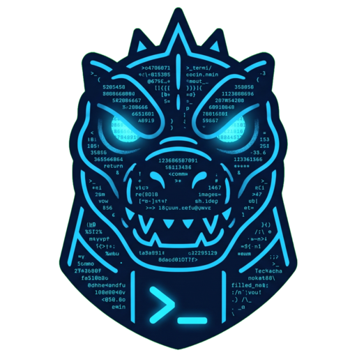

<p align="center">
  
</p>

<h1 align="center">Termonster</h1>

<p align="center">
  A smart terminal for Linux, Windows and macOS, by <a href="https://monstersgate.com">MonstersGate</a>.<br>
  Every command is a block you can read, search and act on. Any output can become a UI and turn back into text,
  and your coding agents can work right inside it.
</p>

<p align="center">
  <a href="https://github.com/MahmoudAdelMansour/Termonster-Releases/releases/latest"><b>Download the latest version</b></a>
</p>

---

## Downloads

Every release has these files. Pick the one for your computer from the [latest release](https://github.com/MahmoudAdelMansour/Termonster-Releases/releases/latest).

| Computer | File | How to install |
|---|---|---|
| **Linux** (any distribution, x86-64) | `termonster-VERSION-linux-x86_64.tar.gz` | Unpack it and run `./install.sh`. No root needed; it installs for your user. |
| Debian, Ubuntu, Mint, Pop!_OS | `termonster_VERSION_amd64.deb` | `sudo apt install ./termonster_VERSION_amd64.deb` |
| Arch, Manjaro, EndeavourOS | `termonster-VERSION-1-x86_64.pkg.tar.zst` | `sudo pacman -U ./termonster-VERSION-1-x86_64.pkg.tar.zst` |
| **Windows** 10 / 11 (x64) | `termonster-setup-VERSION.exe` | Run the setup wizard: pick *only for me* (no administrator password) or *all users*, the folder and the shortcuts. Termonster then shows in the Start menu and in Settings › Apps. (`termonster-VERSION-windows-portable.exe` runs without installing.) |
| **macOS** 11+ (Apple silicon and Intel) | `Termonster-VERSION.dmg` | Open it and drag Termonster onto the Applications folder next to it. Opened straight from the disk image, Termonster offers to move itself there. |

The `termonster-<os>-<arch>.gz` files and their `.sha256` checksums are what Termonster's built-in updater downloads. You don't need them for a first install.

### The first time you open it

Termonster isn't code-signed yet, so your system warns you once:

- **Windows:** SmartScreen says *"Windows protected your PC"*. Click **More info → Run anyway**.
- **macOS:** if it says Apple *"could not verify"* Termonster, open **System Settings → Privacy & Security** and click **Open Anyway** next to Termonster. You won't be asked again.
- **macOS, recommended:** the welcome screen checks **Full Disk Access** and has a button that opens the right setting. Without it, commands that touch Mail, Safari or other apps' data fail with *"Operation not permitted"*.
- **Linux:** nothing to do. If you install the `.deb` or Arch package, the menu entry is there right away. The tarball's `install.sh` adds the menu entry, icons, a desktop shortcut and the `termonster` command.

On first start, Termonster checks what it needs (your shell, a settings folder, Git, SSH, a package manager, coding agents). It tells you what's missing and fixes each item with one click.

### Requirements

| | |
|---|---|
| Linux | x86-64, GTK 3 and WebKitGTK 4.1 (`libwebkit2gtk-4.1`, already installed on most desktops) |
| Windows | Windows 10 version 1809 or newer, x64, with the Microsoft Edge WebView2 runtime (built into Windows 11 and up-to-date Windows 10) |
| macOS | macOS 11 Big Sur or newer |

### Verify a download

Every update file comes with a `.sha256`:

```sh
sha256sum -c termonster-linux-amd64.gz.sha256      # Linux
shasum -a 256 -c termonster-darwin-arm64.gz.sha256 # macOS
```

---

## What it does

**A terminal that understands its output**
- **Blocks:** every command and its output is one block. Each block shows where it ran (folder, `user@host`), when, how long it took and how it ended. You can copy, search, fold, share or re-run it.
- **CLI ↔ GUI:** turn the output of `ls -la` into a file manager where you can drag, copy, move and rename, then switch back to text. Every action runs a real, visible command (`mv 'a.txt' 'docs/'`), so your history stays true. The same works for processes, ports, disks, Docker, Git, JSON, CSV and tables.
- **Logs and errors made readable:** `cat` a log and get levels, timestamps, filters and grouped repeats. A failed command gets an explanation underneath (what happened, the likely cause, fix commands you can click into the input).
- **Syntax highlighting** for shell, SQL, every common language, config formats and even pseudo-code, in the input and in the output.
- **A tool guide:** Termonster recognises the tool you're using and explains its flags while you type.

**Programs inside programs**
- **mysql, psql, redis-cli, python, node, php, ssh, docker exec…** Termonster recognises a program by its prompt, so the smart input comes back for it, with its language's highlighting, completion, its own history and a warning before risky statements. This works inside SSH too.
- **Run beside:** start a shell next to a running program instead of quitting it.
- **Drag a running program** (say, a `mysql` session) to the tab bar to give it its own tab.
- **Password prompts** become a real password field. Nothing is echoed, kept or saved in history.

**Who you are, always visible**
- The current user, host and elevation are always shown. Root gets a red edge, SSH shows the host, containers show their name. Switching user or host is quick and always your choice.

**Tools without leaving the terminal**
- **Tool store:** install and update development tools (languages, databases, CLIs) with your system's package manager. You see the exact command first and it runs where you can watch it. It can update everything that needs updating at once.
- **Workflows:** a library of ready commands for the tool you're using. Save your own, for yourself or for everyone on the computer.
- **Projects:** recognises Laravel, Node, Python, Go, Rust and more, and offers their common tasks.
- **Git:** status, branches, staging, diffs, commits, stashes and remotes in a panel, with AI-written commit messages and reviews if you want them.

**Your coding agents, inside Termonster (AI Hub)**
- **Chats with Claude Code, Codex, Gemini CLI and Antigravity**, with each tool call, diff and result drawn as it happens. Permission requests are cards with Allow, Always allow or Deny. You pick the agent, model and permission mode. Every other agent (Copilot CLI, Cursor Agent, OpenCode, Aider, Qwen Code, Goose, Amp…) opens in a terminal tab.
- **Multiverse:** give it a goal and the cheapest model splits it into tasks. Each task goes to the agent and model that fits it best (even across companies), runs in order or in parallel, and hands its notes to the next agent. You see and can change every choice, and the whole mission is written up as a document.
- **Installs that finish:** Termonster installs agents for you and shows the output. It checks the agent really starts, explains warnings and errors in plain words with a fix for each, keeps agents up to date and walks you through signing in.
- **Usage:** tokens and estimated cost per agent, company and model. It shows what Termonster saved you (cheaper models, cached answers) separately from what the providers' own caching saved, and says where each number comes from.
- **Skills store:** find agent skills from GitHub and skill registries, install them for Claude Code, Codex, Gemini or Antigravity, or share your own.
- **AI in the terminal:** explain an output, fix an error or suggest a command with `/` in the input. It uses Claude, Gemini or Codex through the plan you already have, an API key, or a local Ollama model.

**Yours to shape**
- **Themes** (MonstersGate dark and light plus many classics), fonts, cursor and layout. Import keymaps from VS Code, Warp or iTerm2. Sync your settings through a folder.
- **Smart off:** one switch turns Termonster into a plain, fast terminal. Every smart feature can also be switched off on its own, and so can the startup intro.

**Everywhere on your computer**
- Make it the **default terminal**. On Linux, Ctrl+Alt+T then opens Termonster on KDE Plasma, GNOME, Cinnamon, XFCE and MATE, and "Open in Terminal" uses it too.
- **"Open in Termonster"** in Files, Dolphin and Nemo, and `termonster .` from any terminal.
- **Updates itself:** it checks this page for new versions and installs them in the background (or tells you, if you prefer). Each download is checked against its checksum, and you can go back to the previous version in one click. Copies installed with apt or pacman are updated by your package manager.

---

## Privacy

Termonster has no telemetry and no analytics. It connects to the internet only when:

- it checks this page for updates (you can turn that off in **Settings › Updates**);
- you install something from the tool store or the skills store;
- you use an AI feature or a coding agent. Then it talks to the provider you chose, with your own sign-in or key. Keys are stored only on your computer, in a file only your user can read.

## Uninstall

- **Windows:** **Settings › Apps › Termonster › Uninstall** (or the Termonster uninstaller in the Start menu search).
- **Linux:** run `termonster uninstall`, or use **Settings › Install & open anywhere**. Add `--purge` to remove your settings too. A `.deb` or Arch package is removed with `sudo apt remove termonster` or `sudo pacman -R termonster`.
- **macOS:** run `termonster uninstall`, or drag Termonster from Applications to the Bin.

## Support

Found a bug or have an idea? [Open an issue](https://github.com/MahmoudAdelMansour/Termonster-Releases/issues).

<p align="center"><sub>Termonster © MonstersGate</sub></p>
